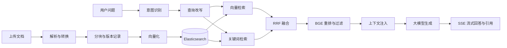

# Know Engine · 通用知识问答 RAG

基于 Java 21、Spring Boot 和 LangChain4j 的知识问答项目。将文档转换为可检索的知识片段，结合向量与关键词检索生成带引用的回答，并通过评测用例观察检索和回答质量。

## 核心流程

普通聊天走独立分支；上图展示知识问答路径。

## 功能与代码入口

| 功能 | 实现入口 |
| --- | --- |
| 文档上传、解析、分块和版本管理 | `document/service/impl/DocumentProcessServiceImpl.java` |
| 长度、标题、正则、智能、分隔符五种分块策略 | `rag/splitter/DocumentSplitterFactory.java` |
| 分块事务提交后异步向量化 | `document/event/DocumentEventListener.java` |
| 向量化补偿与旧版本清理 | `document/job/DocumentCompensationJob.java` |
| 问答编排、进度通知、回答持久化 | `chat/service/ChatService.java` |
| 双通道召回与重排 | `rag/KnowEngineElasticsearchContentRetriever.java`、`rag/KnowEngineReRankingContentAggregator.java` |
| 检索指标计算与模型评分 | `eval/metrics/` |
| 评测运行、报告和对比 | `eval/controller/RagEvalController.java` |

Java 路径均相对 `src/main/java/know/engine/`。

## 数据分工

- **MySQL**：文档、版本、分段、会话、消息及评测记录。
- **MinIO**：源文件和解析产物。
- **Elasticsearch**：文本与向量检索。
- **Redis / Redisson**：处理过程的分布式锁。
- **本地 ONNX 模型**：对问题与候选片段进行 BGE 重排。
- **模型 API**：查询改写、文本向量化、回答生成及可选评测评分。

## 本地运行准备

已提供独立 Compose 依赖配置，按 [本机运行指南](docs/local-runtime.md) 启动 MySQL、Redis、ES、MinIO，再运行 Java 和 React。

已验证 Compose 四项依赖、Java 后端启动、列表接口及 TXT 上传存储。完整问答与复杂文档解析的待办见上述运行指南。

1. 准备 JDK 21、Maven、MySQL、Redis、Elasticsearch、MinIO；复杂文档解析还需要兼容本项目调用方式的解析服务。
2. 创建空数据库 `know_engine`，导入 `src/main/resources/sql/schema.sql`。该文件仅包含表结构；不要向已有业务数据库导入原始转储。
3. 在 `src/main/resources/application-local.yml` 配置本机服务与模型 API Key，通过 `local` profile 启动。此文件已加入忽略规则。默认配置中的密码是本地开发示例。
4. 将匹配的 `model_quantized.onnx` 和 `tokenizer.json` 放入 `src/main/resources/model/bge-reranker-model/`。模型文件约 571 MB，未纳入 Git；具体模型来源、版本与下载说明待补齐。
5. 核对 `application.yml` 以及 `ai/config/AiModelConfig.java` 中的模型名称是否可用，创建 MinIO 的 `know-engine` bucket，并确认 ES 向量维度与 embedding 配置一致。
6. 执行 `mvn spring-boot:run -Dspring-boot.run.profiles=local`。

默认端口 `8009`，页面入口：

| 页面 | 地址 |
| --- | --- |
| 上传文档 | `http://localhost:8009/upload.html` |
| 管理文档 | `http://localhost:8009/document.html` |
| 对话 | `http://localhost:8009/chat.html` |
| 评测报告 | `http://localhost:8009/eval-report.html` |

项目使用默认用户，尚未提供完整登录鉴权；展示可先采用本地演示。

## 示例与评测

`src/main/resources/testFile/` 提供虚构的“曙光智造园区”资料，包含 Markdown、TXT、DOCX、PDF、XLSX、CSV。完整评测集 `eval-test-all.jsonl` 包含 100 条题目。

例如：上传园区概览后，询问“曙光智造园区的内部代号是什么？”，期望回答为 `Aurora-7`，并引用相应片段。

评测包含 Hit@K、MRR、Recall@K 三项检索指标，以及忠实度、相关性、答案正确性、上下文精确率、上下文召回率五项模型评分。Hit@K 统计前 K 个结果是否命中标注证据，回答质量另行评估。

数据集携带既有文档 ID 与分块 ID。重新上传、切分后，应重新核对标注映射，再运行评测。历史 SQL 转储中保存了 Hit@5 为 75%、91%、98% 的运行记录；本轮尚未复测，仓库不将其作为当前版本的复现实测结果。99% 的结果仍待核对。

## 阅读顺序

1. 先跟随一个问题阅读 `ChatController → ChatService`，理解每步输入输出。
2. 再跟随一份文档阅读上传、转换、分块、向量化，理解数据从哪里来。
3. 阅读检索器、RRF 和 BGE，理解召回、排序、过滤分别解决什么问题。
4. 阅读评测标注和指标计算，理解效果如何被衡量。
5. 最后阅读版本切换、分布式锁、异步事务和补偿，检查失败后如何恢复。
